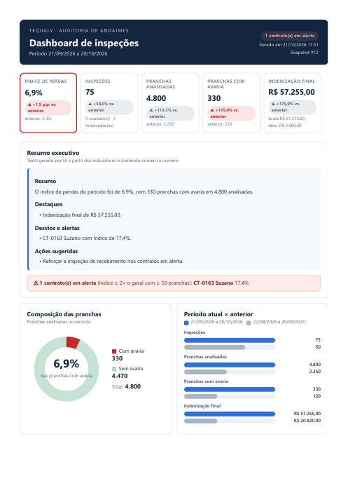

# Automação de Dashboards da Auditoria — Tequaly (n8n + PostgreSQL + Claude)

Pipeline que valida as chaves de API das fontes, extrai e valida (data quality) os dados de inspeção de andaimes, calcula os KPIs em SQL, gera um resumo executivo com a API do Claude e envia **um dashboard único em PDF por e-mail** todos os dias.



## Conteúdo do repositório

| Pasta | O que tem |
|---|---|
| [`bpmn/`](bpmn/) | Processo do projeto em BPMN 2.0 (`auditoria_automacao_dashboards.bpmn`), da demanda à entrega em produção |
| [`workflows/WF00_pipeline_auditoria_completo.json`](workflows/WF00_pipeline_auditoria_completo.json) | **Automação global** em um único canvas (todas as etapas visíveis) |
| [`workflows/blocos/`](workflows/blocos/) | Os mesmos blocos separados: WF00 orquestrador + WF10, WF20, WF30, WF40 e WF99 |
| [`sql/`](sql/) | Esquema PostgreSQL, consultas de cada nó e consultas de conferência |
| [`dashboards/`](dashboards/) | Modelo do dashboard (código), exemplo real em PDF, corpo do e-mail e versões anteriores |
| [`docs/`](docs/) | Diagrama de arquitetura (PDF) e mockup do canvas n8n |

## Por que bpmn.io no lugar do Bizagi

O mapeamento de processos saiu do **Bizagi** e passou para o **bpmn.io** (padrão BPMN 2.0 em XML aberto):

- **Arquivo texto versionável:** o `.bpmn` é XML puro, vai para o Git, tem diff e revisão como código, sem formato proprietário nem licença.
- **Pronto para automação:** o mesmo arquivo pode ser lido e gerado por scripts, pipelines e pelo n8n, e aberto em qualquer editor BPMN (bpmn.io, Camunda Modeler, demo.bpmn.io).
- **Legível por IA:** modelos de linguagem leem, explicam, validam e geram BPMN em XML diretamente, o que acelera desenhar AS-IS/TO-BE e transformar processo em automação.

Para visualizar ou editar: abra o arquivo em <https://demo.bpmn.io> (arrastar e soltar) ou no Camunda Modeler.

## Arquitetura

```
Agendamento 06:00 / Formulário
        │
        ▼
① WF10 Validar chaves ─► ② WF20 Extrair + DQ + carga (1x por endpoint) ─► ③ WF30 KPIs em SQL + narrativa Claude
                                                                                  │
                            ⑤ pipeline_log ◄─ WF00 consolida ◄─ ④ WF40 dashboard PDF por e-mail
Falhas não tratadas ─► WF99 (erro_log + alerta)
```

- **Banco:** PostgreSQL, schema `auditoria` (staging, mart `vw_inspecoes`, snapshots de KPIs e logs).
- **Números:** saem sempre do SQL. O Claude só redige o resumo, e cada número citado é conferido contra os KPIs; se não bater, o texto é descartado.
- **Saída:** um PDF (gráficos SVG, tabelas, metodologia) anexado a um e-mail com resumo compatível com Gmail/Outlook.

## WF00 — Pipeline de auditoria (automação global)

Entrada diária às 06:00 ou pelo formulário "Rodar pipeline manualmente" (período opcional; vazio = últimos 30 dias). Executa em sequência:

1. **Validação de chaves:** testa a chave de cada fonte ativa e grava o status.
2. **Extração, carga e data quality:** lista os endpoints ativos e chama o WF20 uma vez por endpoint, isolando o lote de cada um.
3. **KPIs + narrativa:** agrega em SQL, formata e pede o resumo ao Claude.
4. **Dashboard por e-mail:** monta o dashboard único, gera o PDF e envia.
5. **Consolidação:** grava uma linha em `pipeline_log` com status `OK`, `PARCIAL` ou `SEM_FONTES` e um resumo legível.

Existem duas formas equivalentes no repositório:
- **`WF00_pipeline_auditoria_completo.json`:** todas as etapas em um canvas, com caixas coloridas por etapa e um tratamento de erro próprio. Só a extração por endpoint continua isolada no WF20.
- **`blocos/WF00_orquestrador.json`:** chama WF10 → WF20 → WF30 → WF40 como sub-workflows; os erros vão para o WF99.

Publique **só um dos dois**: ambos têm o agendamento das 06:00.

## Workflows separados (`workflows/blocos/`)

| Workflow | O que faz |
|---|---|
| **WF10 — Validar chaves** | Lê `fontes_sistema`, chama o endpoint de teste de cada fonte com a credencial do n8n e classifica em VALIDA (2xx), INVALIDA (401/403) ou INDETERMINADA (rede, 5xx, 429; não muda o status). Grava `validacao_log` e avisa o dono só quando o status muda ou a chave está a menos de 15 dias de expirar. Devolve as fontes aptas. |
| **WF20 — Extrair, carregar e DQ** | Processa 1 endpoint: extração incremental por watermark e paginação, regras de qualidade por registro (chave, obrigatórios, datas) e por lote (taxa de rejeição acima do limite bloqueia a carga e alerta o dono). Upsert transacional em `staging_registros`; o watermark só avança em carga aprovada. Devolve a linha de `carga_log` (APROVADA, BLOQUEADA, SEM_NOVOS, ERRO ou PULADA). |
| **WF30 — KPIs e narrativa** | O nó "Consultar KPIs (SQL)" agrega no banco o período e o período anterior, por contrato, fornecedor e semana, com alertas. "Calcular KPIs" formata em pt-BR. O Claude redige o resumo, e "Validar narrativa" descarta o texto se houver número fora dos KPIs. Salva o snapshot em `kpi_snapshots`. |
| **WF40 — Dashboard por e-mail** | Lê o snapshot e os destinatários ativos, monta o dashboard único (HTML do PDF + HTML do e-mail), gera o PDF (PDF.co), baixa o arquivo e envia um e-mail para todos com o PDF anexo. Não reenvia snapshot já ENVIADO e registra ENVIADO/FALHA em `envio_log`. |
| **WF99 — Tratar erros** | Workflow de erro global dos demais: grava toda falha não tratada em `erro_log` e manda alerta por e-mail, no máximo um por hora para o mesmo erro. |

Detalhes nó a nó: [`workflows/README.md`](workflows/README.md). SQL de cada nó: [`sql/02_consultas_n8n.sql`](sql/02_consultas_n8n.sql).

## Modelos de dashboard

| Arquivo | Descrição |
|---|---|
| [`dashboards/modelo/montar_dashboard.js`](dashboards/modelo/montar_dashboard.js) | Código do modelo atual (expressão do nó "Montar dashboard"). Gera o HTML do PDF e o HTML do e-mail. |
| [`dashboards/exemplo/dashboard-auditoria-exemplo.pdf`](dashboards/exemplo/dashboard-auditoria-exemplo.pdf) | PDF real gerado pela automação (dados fictícios). |
| [`dashboards/exemplo/email-exemplo.png`](dashboards/exemplo/email-exemplo.png) | Corpo do e-mail que acompanha o PDF. |
| [`dashboards/historico/`](dashboards/historico/) | Versões anteriores: v1 (relatório por perfil auditor/gestor/diretoria) e v2 (dashboard único simples). |

Conteúdo do PDF: 5 cards de KPI com variação, resumo executivo, alerta de contratos, composição das pranchas (rosca), período atual × anterior, tendência semanal, índice por contrato com linhas de referência, indenização por fornecedor, tabelas de detalhamento e metodologia.

## Como implantar

1. Rode [`sql/01_schema_auditoria.sql`](sql/01_schema_auditoria.sql) no PostgreSQL. O n8n precisa alcançar o banco; o script pode ser executado de novo sem perder dados.
2. No n8n, importe os JSON (**Workflows → Import from File**). Importe primeiro WF99, WF10, WF20, WF30 e WF40, depois o WF00.
3. Ajuste o que depende da instância:
   - **IDs de sub-workflow:** os nós *Execute Workflow* do WF00 apontam para os IDs da instância original; selecione os workflows importados.
   - **Error workflow:** em *Settings → Error workflow* de WF00/10/20/30/40, selecione o WF99.
4. Crie e vincule as credenciais:
   - **Postgres:** "Postgres Auditoria", em todos os nós Postgres.
   - **Anthropic API:** nós "Testar Claude API" e "Gerar narrativa".
   - **Header Auth:** API do sistema interno, nos nós "Testar API (Header Auth)" e "Extrair registros".
   - **SMTP:** nós de e-mail; troque `auditoria@suaempresa.com.br` pelo remetente real.
   - **PDF.co:** ou troque por Gotenberg on-premises.
5. Cadastre as fontes, endpoints e destinatários reais nas tabelas `auditoria.*`.
6. Ajuste os nomes dos campos da API na view `auditoria.vw_inspecoes`.
7. Rode pelo formulário e confira com [`sql/03_verificacao.sql`](sql/03_verificacao.sql). Depois publique o WF00 escolhido.

## Segurança e dados

- **Chaves e senhas:** ficam só nas credenciais do n8n; nenhum segredo está nos arquivos.
- **SQL:** todas as consultas usam parâmetros (`$1`, `$2`…), sem concatenar valores, o que evita injeção.
- **Serviços externos:** o PDF.co e a API do Claude recebem dados de auditoria; valide com a TI antes de usar dados reais.
- **E-mails:** os endereços deste repositório são exemplos (`auditoria@suaempresa.com.br`).
